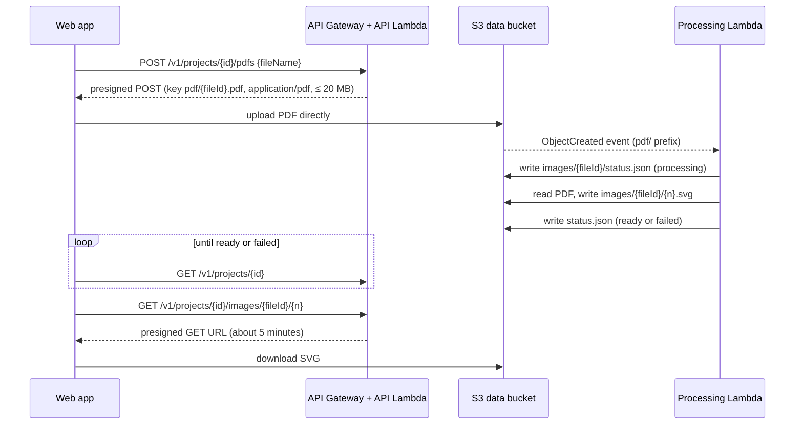

# Data Design

How project data is stored in S3, and how the web app and server work with it. Covers
requirements DA-1 to DA-8 in [`../high-level-requirements.md`](../high-level-requirements.md)
and decisions AD-3 and AD-6 to AD-12 in [`decisions.md`](decisions.md).

## S3 layout (data bucket)

```text
users/{sub}/
├── projects.json                        # project list: IDs, names and timestamps
└── projects/{projectId}/                # one folder per project
    ├── pdf/{fileId}.pdf                 # 1–2 uploaded PDFs (≤ 20 MB each)
    ├── images/{fileId}/status.json      # processing status for that PDF
    ├── images/{fileId}/{n}.svg          # one SVG per PDF page (n = 1, 2, …)
    └── data/{name}.json                 # 2–3 structured data files from the app
```

- `{sub}` is the Cognito user ID, taken **only** from the verified JWT.
- `{projectId}` and `{fileId}` are random IDs (e.g. ULID/UUID) generated by the server.
  User-defined names are kept in `projects.json`, never in S3 keys.
- The original file name of an uploaded PDF is stored as S3 object metadata
  (`x-amz-meta-filename`), set by the presigned upload.

## Project list (`projects.json`)

The list holds only project-level information. Each project's folder is not stored: it is
computed from the user's `{sub}` and the project's `id` as `users/{sub}/projects/{id}/`.
The list does not list individual files: the folder's contents are the source of truth.

```json
{
  "version": 1,
  "projects": [
    {
      "id": "01JC8Z6Q4V7K3M2N9P0R5S1T2U",
      "name": "Smith Street extension",
      "createdAt": "2026-11-08T10:15:00Z",
      "updatedAt": "2026-11-08T10:20:00Z"
    }
  ]
}
```

**Write rule:** only the API Lambda writes `projects.json`, and only when a project is
created, renamed or deleted. Each update reads the file, changes it, and writes it back with
`If-Match: <ETag>`. If the write fails because the file changed in the meantime
(HTTP 412, e.g. two browser tabs), the Lambda reads it again and retries.

## Processing status (`images/{fileId}/status.json`)

```json
{ "status": "ready", "pages": 2, "updatedAt": "2026-11-08T10:20:00Z" }
```

`status` is `processing`, `ready` or `failed` (with an `error` message). A PDF with no status
file yet is treated as `pending`. Only the processing Lambda writes this file, or its
failure handler after the processing Lambda has stopped (AD-10), so there is one writer at a
time and no conflict handling is needed.

## Page limit

A presigned upload can limit file size but not page count, so the 20-page limit is checked
**in the processing Lambda, before rendering**. It opens the PDF and checks the page count 
first. If there are more than 20 pages, or the file is not a valid PDF, it writes 
`status: failed` with an `error` message, deletes the uploaded PDF, and generates no images.

## Time limit

Images must be ready within 2 minutes of the upload completing.

- **Processing Lambda:** checks the elapsed time after each page. If the 2-minute budget is
  used up, it stops, deletes any images already written for that PDF, and writes
  `status: failed` with a "took too long" error.
- **Crash or timeout:** if the Lambda fails without writing a status, its on-failure
  destination writes `status: failed`, so a PDF never stays in `processing`.
- **Web app:** polls `GET /v1/projects/{id}` (e.g. every 3 seconds) until the status is
  `ready` or `failed`. If neither arrives within about 3 minutes, it stops polling and tells
  the user generation failed.

## Finding a project's files

`GET /v1/projects/{id}` checks the project is in the caller's `projects.json`, lists the
project folder (`ListObjectsV2` on its prefix), reads each `status.json`, and returns:

```json
{
  "id": "01JC8Z6Q4V7K3M2N9P0R5S1T2U",
  "name": "Smith Street extension",
  "pdfs": [
    {
      "id": "01JC8Z7A…",
      "fileName": "ground-floor.pdf",
      "status": "ready",
      "images": ["1.svg", "2.svg"]
    }
  ],
  "data": ["measurements.json", "settings.json"]
}
```

A project holds only a handful of files, so one listing call is enough.

## Main flows

### Upload a PDF and generate images



### Delete a project

The API Lambda removes the entry from `projects.json` first, so the project disappears from
the list straight away. It then deletes every object in the project's folder. Old object
versions are removed later by the lifecycle rule.

## API outline (draft)

| Method and path | Purpose |
| --- | --- |
| `GET /v1/projects` | List projects (from `projects.json`). |
| `POST /v1/projects` | Create a project with a name. |
| `GET /v1/projects/{id}` | Project details: the files in its folder and their processing status. |
| `PATCH /v1/projects/{id}` | Rename a project. |
| `DELETE /v1/projects/{id}` | Delete a project and all its files. |
| `POST /v1/projects/{id}/pdfs` | Get a presigned upload for a new PDF. |
| `GET /v1/projects/{id}/images/{fileId}/{n}` | Get a short-lived download URL for an image. |
| `GET /v1/projects/{id}/data/{name}` | Read a JSON data file. |
| `PUT /v1/projects/{id}/data/{name}` | Save a JSON data file (validated on the server, at most 1 MB). |
