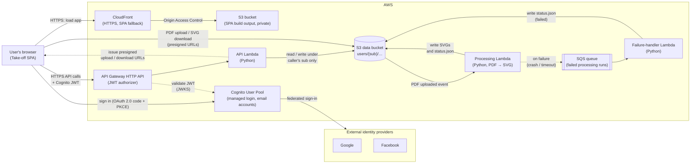

# Deployment Diagram

How Take-off is deployed in AWS. The service choices are recorded in
[`decisions.md`](decisions.md).

## Elements

| Element | Responsibility |
| --- | --- |
| CloudFront | Serves the SPA over HTTPS. Maps unknown paths to `index.html` so client-side routes work. |
| S3 site bucket | Holds the SvelteKit `adapter-static` build. Private; readable only by CloudFront. |
| Cognito User Pool | Stores email accounts, federates to Google and Facebook, and issues ID and access tokens to the SPA. |
| API Gateway HTTP API | Public API endpoint. Its JWT authorizer rejects requests without a valid Cognito token. |
| API Lambda (Python) | Manages projects and JSON data, and issues presigned URLs for PDF uploads and image downloads. Takes the user's identity from the verified `sub` claim. |
| S3 data bucket | Private, encrypted, versioned storage. Each user's objects live under `users/{sub}/`. Layout in [`data-design.md`](data-design.md). |
| Processing Lambda (Python) | Triggered when a PDF is uploaded. Generates SVG images and records the PDF's processing status in a `status.json` beside them. Invoked with no automatic retries. |
| SQS queue | On-failure destination for the processing Lambda. Receives a record of each run that crashed or timed out. |
| Failure-handler Lambda (Python) | Reads the queue and marks the affected PDF `failed` in its `status.json`, so it never stays in `processing`. |
